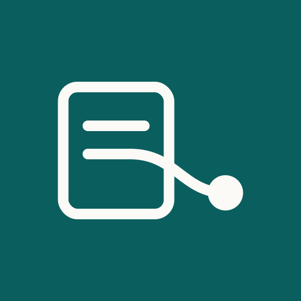

# PM Interview Coach



PM Interview Coach is a plugin for program and project managers, PMO leads and technical program managers (and close roles such as product manager, scrum master and business analyst) who are preparing for a job interview. You paste your resume and, if you have one, the job posting. The plugin follows one path: it reviews the whole resume line by line, matches the posting requirements to your resume lines, finds the resume lines a hiring manager is likely to press on and turns each into a question that quotes your own line, and adds behavioral questions for the role. You then practise one question at a time: you answer in your own words, the plugin checks the structure of the answer, and Claude gives feedback built only from facts you supplied. The session ends with a short scorecard.

The skill instructs Claude never to invent a figure, employer, date or outcome for you, and never to promise any result of an interview. Missing facts are asked for, not filled in.

## What is in this plugin

- `skills/pm-interview-coach/SKILL.md`: the coaching skill. It tells Claude how to run the practice session (one question at a time, no invented facts, feedback order, scorecard).
- `.mcp.json`: one remote MCP server, PM Career Desk, at `https://app.pmcareerdesk.com/mcp`. Its ten free tools need no sign-in and are read-only.
- `assets/`: the PM Career Desk icon (SVG and PNG).

The ten free tools of the PM Career Desk server:

- `review_resume`: reads the whole resume with fixed rules and returns at most 12 flagged lines, each with the finding and the question a hiring manager may ask.
- `match_resume_to_job`: matches the posting requirements to your resume lines (covered, partial, gap), with the years and budget sizes the resume shows.
- `prepare_interview_questions`: reads the resume text and the optional job posting with fixed rules and returns the questions, the points a strong answer includes and the requirement map.
- `check_interview_answer`: checks the structure of one practice answer (situation, your own action, result, a before and after figure or a named record, length, filler words, the balance of "we" and "I").
- `check_linkedin_profile`: checks a LinkedIn headline and About section with fixed rules and returns up to 10 findings, each with the question a recruiter or hiring manager may ask, plus a score per section.
- `check_resume_line`: checks one resume bullet and returns one finding and one question a hiring manager may ask about it.
- `get_pm_title_fit_questions` and `match_pm_title`: nine questions that compare project manager, program manager and technical program manager for your current work, and the closest title.
- `get_pm_archetype_test` and `score_pm_archetype`: the PM Archetype test, for reflection, not a psychometric or hiring assessment.

The skill uses the first five on its path and the other five when you ask for them. Further tools work only after you sign in to a PM Career Desk account with an Interview Coach Pass: a full interview plan by stage, saving and reading your practice progress, a prep file in Word format, and a mock interview. In the mock interview Claude asks 5 to 10 questions for one interview stage, one at a time, with the follow-up questions the tools pick from the structure of your answers; you write every answer, and it ends with a scorecard by competency. The plugin runs nothing on your computer: no scripts, no hooks, no package installs.

## Install

In Claude (web, desktop, Cowork), once the plugin is listed in the directory: open Customize, then Plugins, find PM Interview Coach and add it. Then connect the PM Career Desk connector from the plugin's Connectors tab (no account is needed).

Before the listing is live, you can add only the connector: Customize, then Connectors, then Add custom connector, with the URL `https://app.pmcareerdesk.com/mcp`.

In Claude Code:

```
claude plugin marketplace add DmitriiSelkov/pm-interview-coach
claude plugin install pm-interview-coach@pm-career-desk
```

Then ask, for example:

- "I have a program manager interview next week. Here is my resume and the job posting: prepare the interview questions."
- "Review my whole resume for a PMO lead role and show me the lines a hiring manager is likely to question."
- "Ask me the title fit questions: does my work look more like project manager, program manager or TPM?"

## What is sent, and privacy

When the skill calls a tool, Claude sends the text the tool needs (the resume text, the job posting, a LinkedIn headline and About, or one practice answer) to `https://app.pmcareerdesk.com/mcp`. Nothing else is sent: not your other conversations, not your files, not Claude's memory. Contact details are removed before the rules read the text.

We do not store the text you send through the connector. We count which tool was used.

One exception, only with a signed-in account: practice you ask to save, and the mock interview. By default only the progress is saved (question, structure checks met, date); the text of an answer is kept only when you ask, encrypted with your account key, and every saved item is deleted after 180 days or with your account. During a mock interview your answers are held for the session only, encrypted with your account key; they are removed when you finish, and an unfinished session is deleted after 24 hours.

Links in tool results go to pages of pmcareerdesk.com and carry `from=claude` and the tool name, so we can count visits that came from Claude. They carry nothing about you.

Your conversation with Claude is governed by Anthropic's terms and privacy policy. Our Privacy Notice: <https://pmcareerdesk.com/privacy/>. Terms: <https://pmcareerdesk.com/terms/>.

## AI disclosure

Reed (AI) is the PM Career Desk analyst named in the tool results. Reed is software, not a person. The questions and structure checks come from fixed rules written by the PM Career Desk team; no person reads what you send. The conversation and the feedback are written by Claude, an AI model, in your own Claude session. You decide what to say in an interview.

## Limits

- English resumes and postings. Resume up to 30,000 characters, posting up to 15,000, one answer up to 6,000.
- The question bank is a first version. For some large US employers it adds questions built from the principles and hiring pages the company publishes, with links to those pages. They are our questions, not the company's.
- The structure check does not judge whether a story is true.

## Support

Email support@pmcareerdesk.com. Documentation: <https://pmcareerdesk.com/interview-coach/?from=claude>.

PM Career Desk is a service of PME Consulting, Inc. This plugin is not made or endorsed by Anthropic.

## License

All rights reserved; you may install and use the plugin, not copy or redistribute it. See the LICENSE file.
